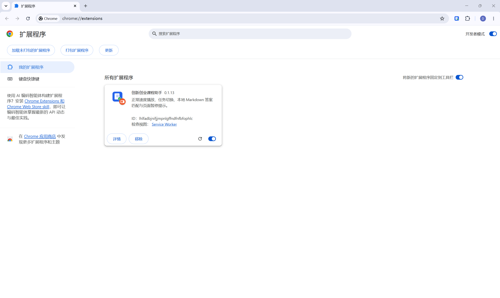
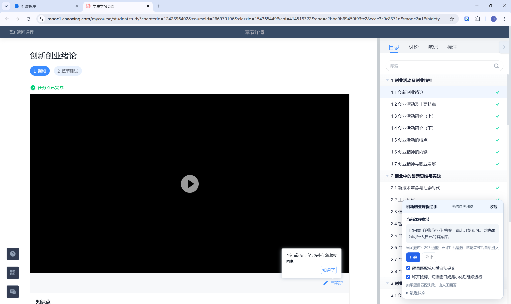

# 创新创业课程助手（Chrome 扩展）

## 使用声明（使用前请阅读）

**1. 仅供学习交流。** 本助手及配套题库、教程仅用于个人学习、技术研究与交流，不是学习通或课程提供方的官方产品。使用者应遵守所在学校、课程和平台的规定，不得用于违反教学管理要求的活动。

**2. 禁止商用。** 禁止出售本助手或配套材料、收费分发、包装为付费产品，或用于收费答题、代学代做等商业服务。转发交流时请保留本声明和原有作者、第三方组件的许可说明。

**3. 能力及题库有限。** 本助手为个人开发、按现状提供，开发和维护能力有限，不保证无错误、持续可用或适配所有页面。当前内置题库共 293 道，覆盖范围有限；课程题目、选项或平台页面发生变化时，可能无法匹配或出现异常。答案仅供参考，不保证全部正确，也不保证成绩、学分或任务记录结果。使用者应自行核对，并在需要时人工处理。

**4. 自主使用，依法承担相应风险。** 是否安装、启用、修改或继续使用本助手，由使用者自行决定。使用者应核对答题和提交结果，并以平台实际记录为准。因使用者违反学校或平台规定、误操作、自行修改程序或将工具用于超出上述范围的活动而产生的后果，由使用者依法承担相应责任；作者及分享者不对成绩、账号状态或平台处理结果作出承诺。

## 安装

1.  解压`chaoxing-helper.zip`

2. 在 Chrome 地址栏输入 `chrome://extensions/`。

3. 打开右上角的“开发者模式”。

4. 点击“加载未打包的扩展程序”，选择**chaoxing-helper** 文件夹。

   

5. 打开学习通，进入创新创业课程学习页面，初次使用可能需要刷新页面，之后点击开始即可。

   

## 功能

- 正常速度播放视频，不倍速、不拖拽，支持后台运行。

- 根据平台完成状态自动切换任务和章节。

- 内置 293 道题，支持单选、多选、判断题及自定义题库导入。

- 题目完整匹配后自动填写、提交并确认。

- 未匹配时暂停并发送桌面通知，支持人工补答后检查并继续。

- 实时显示播放进度、运行状态和课程完成提示。

